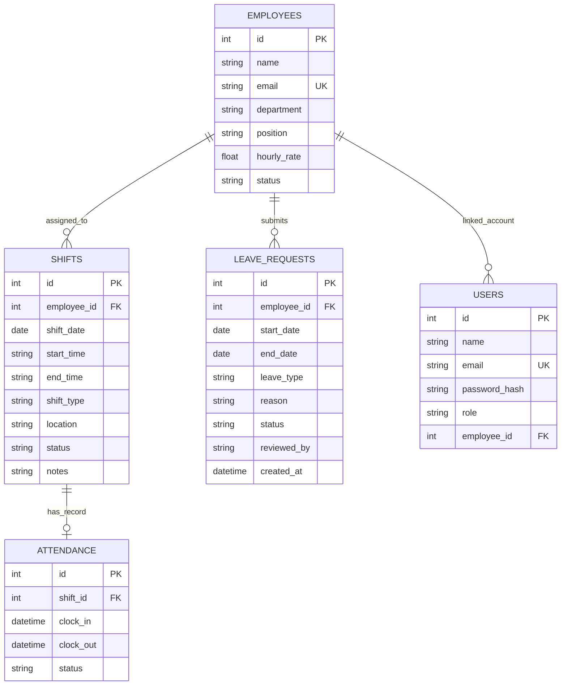

# Database Design

## Entity relationship overview

## Tables and rules

- **employees:** one row per staff member; email is unique; status is Active or Inactive.
- **users:** login identity, salted PBKDF2 password hash, role and optional linked employee record.
- **shifts:** scheduled work assignment. employee_id references employees. Cancelled shifts remain in the database for traceability.
- **attendance:** one attendance record per shift, enforced by a unique shift_id; clock-in and clock-out are timestamps.
- **leave_requests:** requested date range, leave category, reason, decision and reviewer name.

## Relationship notes
- An employee can have many shifts and leave requests.
- A shift has zero or one attendance record at the database level; scheduling creates the attendance row at the same time.
- A user may be linked to an employee profile. The administrator account is not linked to a staff member.
- The current schema does not yet store a separate audit-log table or leave balance ledger; these are possible future extensions.

## Indexes
The API creates an index on shifts.shift_date to support date-range filtering. Production scale would benefit from additional indexes on shifts.employee_id, leave_requests.status, and case-insensitive employee email lookups.

## Data integrity
The API checks overlap, time format, maximum shift duration and leave date order. Additional database-level CHECK constraints and migration scripts would improve integrity for a production version.
